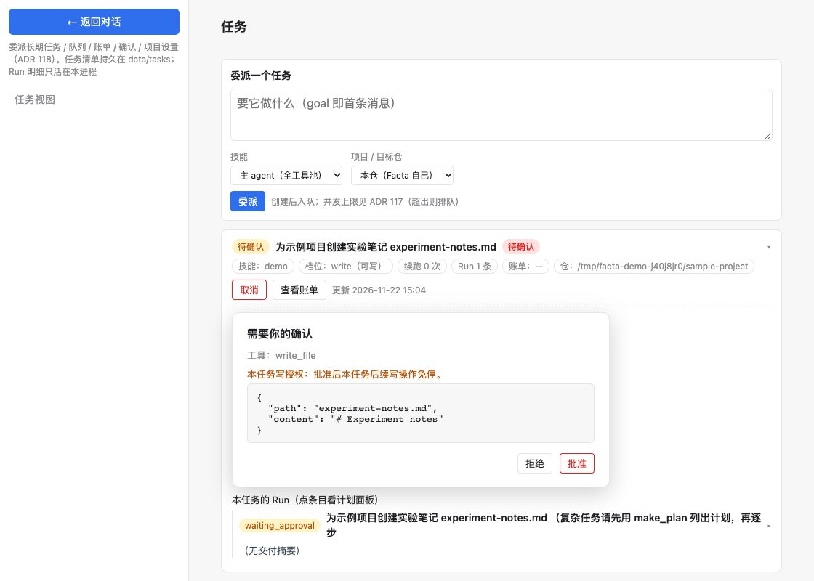
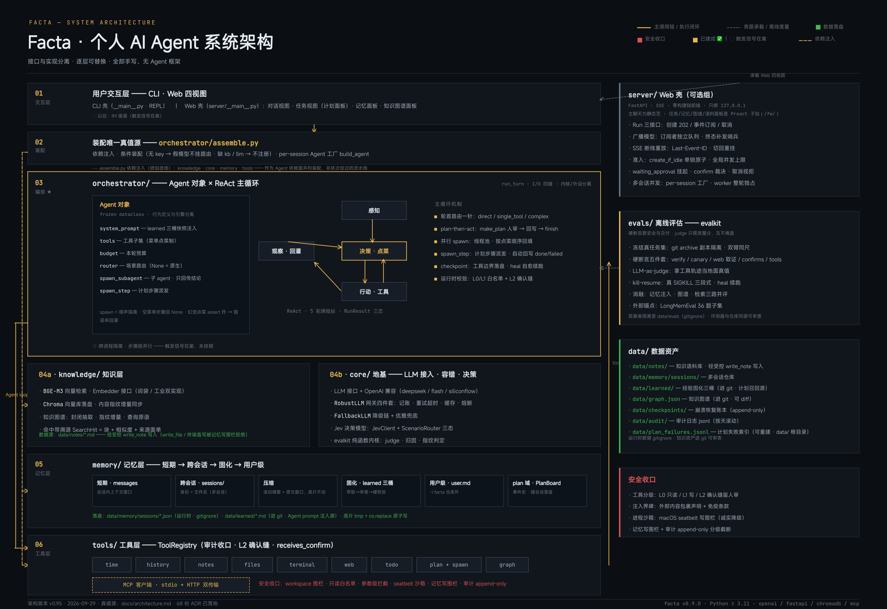
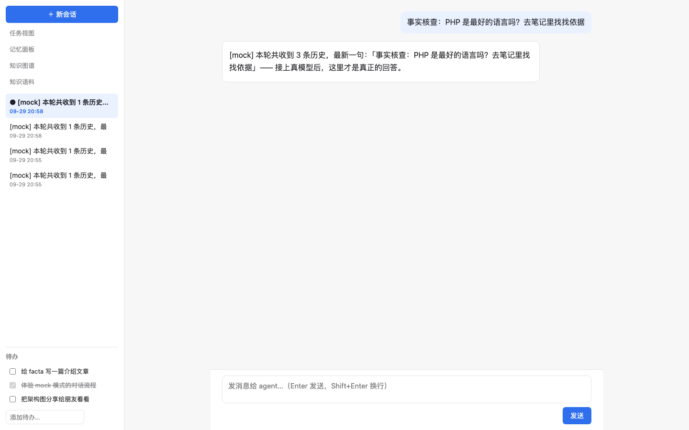
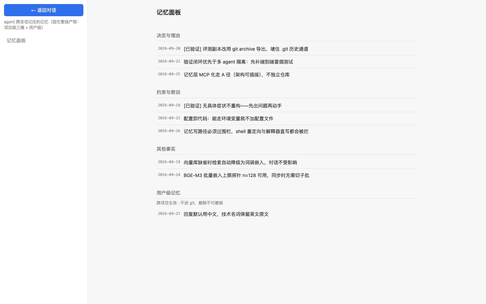
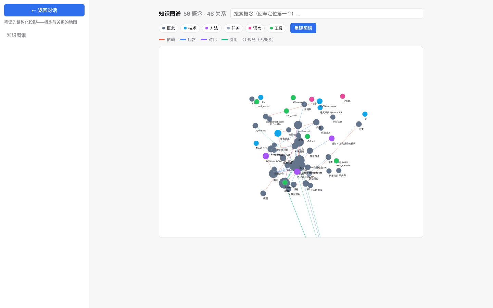

# Facta · 个人 AI Agent / Personal AI Agent

[](https://github.com/Wenyan0315/facta/actions/workflows/ci.yml)
[](https://www.python.org/)
[](LICENSE)

**Facta 是一个从零实现的个人 AI Agent。** 你可以按项目和技能委派长任务，让它在后台排队执行，在任务面板查看进度、审批写入、调整方向或继续任务。各项目可以维护独立记忆。

**Facta is a personal AI agent built from scratch.** Delegate long-running tasks by project and skill, queue them in the background, and use the task panel to track progress, approve writes, steer work, or resume it. Projects can keep separate memory.

## 快速开始 / Quick Start

需要 Python 3.11+。以下命令在 macOS 或 Linux 上运行，mock 模式无需 API key。<br>
Requires Python 3.11+. Run the commands below on macOS or Linux. Mock mode needs no API key.

```bash
git clone https://github.com/Wenyan0315/facta.git
cd facta
python3 -m venv .venv
source .venv/bin/activate
python -m pip install -e ".[web]"
python -m facta mock
```

输入一句话试试，输入 `quit` 退出。要打开 Web 界面，在同一个环境运行下面的命令，然后访问 [本机任务面板](http://127.0.0.1:8000/tasks)。<br>
Send a message, then type `quit` to exit. For the Web UI, run the command below in the same environment and open the [local task panel](http://127.0.0.1:8000/tasks).

```bash
FACTA_PROVIDER=mock python -m facta.server
```

mock 可以用来查看界面和测试对话。要委派实际工作，按下方配置真实模型。<br>
Use mock mode to explore the UI and test chat. Configure a real model below to delegate work.

## 委派长任务 / Delegate a Long-Running Task

1. 在 `/tasks` 填写目标，选择或指定项目目录，并按需选择技能。<br>
   In `/tasks`, describe the goal, choose or specify a project directory, and select a skill if needed.
2. 提交后，任务进入后台队列。你可以查看进度和运行记录、在执行中补充指令，或恢复已暂停的任务。<br>
   Tasks enter a background queue. Inspect progress and run history, steer a running task, or resume a paused one.
3. 使用有写权限的技能时，首次触发文件或笔记写入会在任务面板等待授权。也可以在委派时将该技能的权限收紧为只读。<br>
   For a write-enabled skill, the first file or note write waits for task-level approval in the panel. You can also restrict the skill to read-only when delegating.



截图来自本地浏览器测试，使用脚本化模型和演示数据。<br>
The screenshot uses a scripted model and demo data in a local browser test.

你也可以从任务面板取消任务。已登记项目的记忆可集中存放，也可存放在项目目录下。从 VS Code 扩展源码构建后，可以用 **Facta: 打开任务面板**命令打开同一界面。<br>
You can also cancel a task from the panel. Registered projects can keep memory centrally or inside the project directory. With the VS Code extension built from source, open the same panel using the **Facta: 打开任务面板** command.

长任务面板已合入 `main`，源码版本为 `2.0.0`。设计与验收进展见 [ADR 115](docs/decisions/115-m1-controllable-long-tasks.md)、[ADR 116](docs/decisions/116-m2-bounding-and-skills.md)、[ADR 117](docs/decisions/117-m3-multitask-and-authorization.md) 和 [ADR 118](docs/decisions/118-m4-host-and-release.md)。<br>
The task panel is available on `main`, where the source version is `2.0.0`. The ADRs above track the design and acceptance work.

## 接入真实模型 / Configure a Real Model

复制 `.env.example` 为 `.env`，再填入供应商对应的 API key。CLI 用位置参数选模型，Web 从环境变量或 `.env` 读取 `FACTA_PROVIDER`。<br>
Copy `.env.example` to `.env` and add your provider’s API key. The CLI takes a positional provider argument. The Web server reads `FACTA_PROVIDER` from the environment or `.env`.

```bash
cp .env.example .env
# 编辑 .env 后运行 / Run after editing .env
python -m facta deepseek-flash
# 或启动 Web / Or start the Web server
FACTA_PROVIDER=deepseek python -m facta.server
```

省略供应商时，CLI 默认 `deepseek-flash`，Web 默认 `deepseek`。需要向量库或 HTTP MCP 客户端时，安装 `python -m pip install -e ".[rag,web]"`。<br>
The CLI defaults to `deepseek-flash`, and the Web server defaults to `deepseek`. For the vector store or HTTP MCP client, install with `python -m pip install -e ".[rag,web]"`.

### 支持的供应商 / Providers

| 供应商 / Provider | 配置前缀 / Prefix | 默认 base_url / Default | 默认模型 / Default model | embedding 可用 / Embedding options |
|---|---|---|---|---|
| `mock` / `echo` / `repeat` | （无 key，教学 / no key, teaching） | — | — | 词袋 / bag-of-words |
| `deepseek` / `deepseek-flash` | `DEEPSEEK_` | api.deepseek.com | deepseek-chat / deepseek-flash | — |
| `siliconflow` | `SILICONFLOW_` | api.siliconflow.cn/v1 | DeepSeek-V3 | `siliconflow`（默认 / default）/ `openai` |
| `openai` | `OPENAI_` | api.openai.com/v1 | gpt-4o-mini | `openai`（设 / set `FACTA_EMBED_PROVIDER=openai`）/ `siliconflow` |
| `qwen` | `DASHSCOPE_` | dashscope.aliyuncs.com/compatible-mode/v1 | qwen-plus | `siliconflow` / `openai` |
| `zhipu` | `ZHIPU_` | open.bigmodel.cn/api/paas/v4 | glm-4-flash | `siliconflow` / `openai` |
| `moonshot` | `MOONSHOT_` | api.moonshot.cn/v1 | moonshot-v1-8k | `siliconflow` / `openai` |

不在表里的中转商不必改代码：用 `{PREFIX}_BASE_URL` + `{PREFIX}_MODEL` 直接覆盖默认。embedding 通过 `FACTA_EMBED_PROVIDER`（默认 `siliconflow`）切换；缺 key 或未装 `[rag]` 时自动降级词袋嵌入，对话不报错（只是检索质量变差）。详见 [ADR 070](docs/decisions/070-multi-provider-compatibility.md)。

Providers not listed need no code changes: override defaults directly with `{PREFIX}_BASE_URL` + `{PREFIX}_MODEL`. Embeddings switch via `FACTA_EMBED_PROVIDER` (default `siliconflow`); a missing key or uninstalled `[rag]` degrades to bag-of-words embeddings — chat keeps working (only retrieval quality drops). See [ADR 070](docs/decisions/070-multi-provider-compatibility.md).

### 可选能力 / Optional capabilities

这两件不配置也能跑，配了多两块能力（`.env.example` 里都有现成注释行）：

- **联网搜索 / Web search**：填 `TAVILY_API_KEY`（或 `BOCHA_API_KEY`，博查优先）。不填则 `web_search`/`fetch_web` 自动不上工具菜单，其余功能不受影响。
  Set `TAVILY_API_KEY` (or `BOCHA_API_KEY`, which takes precedence). Without it the `web_search`/`fetch_web` tools simply stay off the menu — everything else works.
- **场景路由 / Scenario routing (M10)**：填 `JEV_API_KEY`（可选 `JEV_BASE_URL`）。轮首由 Jev 按 direct / single_tool / complex 决定工具菜单形状；不填走原生全菜单路径，mock 模式自动跳过。
  Set `JEV_API_KEY` (optional `JEV_BASE_URL`) for per-turn direct / single_tool / complex routing; without it the agent uses the native full-menu path (skipped automatically in mock mode).

### 测试 / Tests

```bash
python -m pip install -e ".[dev,rag,web]"
python -m pytest
ruff check src/ evals/ tests/
mypy
```

浏览器冒烟用例另需 Chromium，可用 `python -m playwright install chromium` 安装。<br>
The browser smoke tests also need Chromium. Install it with `python -m playwright install chromium`.

## 系统架构 / Architecture



Facta 无需 Agent 框架。编排、记忆、检索、工具和模型接入分层实现，可以独立替换。<br>
Facta implements orchestration, memory, retrieval, tools, and model access without an agent framework. Each layer can be replaced independently.

完整设计见[架构文档](docs/architecture.md)与[决策记录](docs/decisions/)。<br>
See the [architecture guide](docs/architecture.md) and [architecture decision records](docs/decisions/) for the full design.

## 特性 / Features

- **ReAct 主循环 / ReAct loop**：感知 → 决策 ⇄ 工具调用 → 观察；模型掌握决策权，程序掌握执行权。<br>
  Perceive → decide ⇄ call tools → observe; the model owns decisions, the program owns execution.
- **九族内置工具 / Nine built-in tool families**：time / history / notes / files / terminal / web / todo / plan+spawn / graph；另有 stdio + HTTP 双传输的 MCP 客户端。<br>
  time / history / notes / files / terminal / web / todo / plan+spawn / graph; plus an MCP client over both stdio and HTTP transports.
- **Plan-then-act 人审掌舵 / Plan-then-act with human steering**：复杂任务先出计划等人批准，步骤派发自动回写，终态收官校验。<br>
  Complex tasks start with a plan awaiting approval; dispatched steps write back automatically, and final states are verified at close-out.
- **场景路由 / Scenario routing**：轮首一针按 direct / single_tool / complex 决定工具菜单形状（可插拔，缺席走原生路径）。<br>
  One classifier call per turn (direct / single_tool / complex) shapes the tool menu (pluggable; absent → native path).
- **多层记忆 / Layered memory**：会话内消息、滚动摘要（底片不动）、跨会话多会话、`data/learned` 三桶固化管线（萃取 → 枚举审查 → 硬校验）、用户级记忆外置。<br>
  In-session messages, rolling summaries (originals never mutated), cross-session recall, a three-bucket consolidation pipeline for `data/learned` (extract → enumerated review → hard validation), and externalized user-level memory.
- **RAG 知识层 / RAG knowledge layer**：BGE-M3 向量嵌入 + ChromaDB 增量向量库 + 知识图谱（抽取 / 增量同步 / 查询原语），检索带出处。<br>
  BGE-M3 embeddings + an incremental ChromaDB vector store + a knowledge graph (extraction / incremental sync / query primitives); retrieval always carries provenance.
- **LLM 网关 / LLM gateway**：OpenAI 兼容接口；记账、重试超时、双档缓存、熔断四件套 + FallbackLLM 降级链。<br>
  An OpenAI-compatible interface with metering, retry/timeout, two-tier caching, and circuit breaking, plus a FallbackLLM degradation chain.
- **崩溃恢复 / Crash recovery**：工具边界落盘账本，进程被 kill -9 后重启自动 heal，已记录的结果原样恢复；结果未知的副作用会提示模型先核验再继续。<br>
  A ledger is persisted at tool boundaries; after a kill -9 the process self-heals on restart — recorded results are restored as-is, and side effects with unknown outcomes prompt the model to verify before continuing.
- **安全收口 / Safety gates**：L0/L1 命令白名单 + L2 确认缝、外部命令三档执行隔离（`FACTA_SANDBOX`：none / workspace-write / container；后端按平台探测 seatbelt 或 bwrap，无可用后端时诚实降级不假装有围栏）× 三档确认策略（`FACTA_APPROVAL_POLICY`：untrusted / on-request / never）、记忆写入围栏、审计 append-only；当前档位与实际后端在 Web 侧栏徽章直接可见。<br>
  L0/L1 command whitelists + an L2 confirmation gate, three-tier sandboxing for external commands (`FACTA_SANDBOX`: none / workspace-write / container; seatbelt or bwrap backend detected per platform, with honest degradation when no backend is available) × three-tier approval policy (`FACTA_APPROVAL_POLICY`: untrusted / on-request / never), a memory-write fence, and append-only audit logs; the configured level and actual backend are visible on the web sidebar badge.
- **CLI + Web 双壳 / CLI + Web shells**：FastAPI + SSE 流式（仅绑 127.0.0.1），零构建对话壳 + Preact 五入口（任务 / 记忆 / 知识图谱 / 语料 / MCP 配置）。<br>
  FastAPI + SSE streaming (bound to 127.0.0.1 only): a zero-build chat shell plus five Preact entries — tasks / memory / knowledge graph / corpus / MCP config.
- **离线评估 / Offline evaluation**：冻结题库 + git archive 副本剥离 + 注入金丝雀 + LLM-as-judge，CI 中与单元测试同跑。<br>
  A frozen scenario bank + git-archive copy isolation + injection canaries + LLM-as-judge, running in CI alongside unit tests.

## 其他界面 / More Screens

<details>
<summary>对话、记忆和知识图谱 / Chat, memory, and knowledge graph</summary>

| 对话 / Chat | 记忆 / Memory | 知识图谱 / Knowledge graph |
|---|---|---|
|  |  |  |

</details>

## 竞品对照 / Competitive Comparison

[2026 年 9 月的 25 维对标图](docs/assets/competitive-comparison.png)记录了当时的能力、负面结果与失效边界。<br>
The [September 2026 comparison across 25 dimensions](docs/assets/competitive-comparison.png) records the capabilities, negative results, and failure modes observed at the time.

## 项目结构 / Layout

```
src/facta/
├── orchestrator/   # 编排层：run_turn 主循环、Agent 对象、依赖装配、崩溃账本 / orchestration: run_turn loop, Agent, DI assembly, crash ledger
├── tools/          # 工具层：ToolRegistry + 九族工具 + MCP 客户端 + 沙箱 / tools: ToolRegistry + nine families + MCP client + sandbox
├── core/           # 地基层：LLM 接口、网关四件套、场景路由、evalkit / core: LLM interface, gateway suite, scenario routing, evalkit
├── knowledge/      # 知识层：RAG 检索、向量库、知识图谱 / knowledge: RAG retrieval, vector store, knowledge graph
├── memory/         # 记忆层：会话、压缩、固化三桶、计划板 / memory: sessions, compression, three-bucket consolidation, plan board
├── server/         # Web 壳（FastAPI + SSE）与前端静态资源 / web shell (FastAPI + SSE) and frontend static assets
└── github_bot/     # GitHub bot 壳：非交互 worker、任务提示词 / GitHub bot shell: non-interactive worker, task prompts
evals/              # 离线评估：冻结题库、注入题库、judge / offline evals: frozen scenarios, injection bank, judge
servers/            # MCP 演示服务器 / MCP demo servers
vscode/             # VS Code 壳（最小宿主：单跳 iframe + IDE 上下文桥）/ VS Code shell (minimal host)
tests/              # pytest 测试 / pytest tests
docs/               # 架构文档与 ADR / architecture docs and ADRs
data/               # 语料与运行时数据（notes/learned.example 入库，其余 gitignore）/ corpus & runtime data (notes + learned.example tracked; the rest gitignored)
```

装配遵循「唯一真值源」：CLI、Web 与 GitHub bot 三个壳都经 [orchestrator/assemble.py](src/facta/orchestrator/assemble.py) 依赖注入，条件装配（无 key 不挂路由、缺向量库不注册 RAG）。

Assembly follows a "single source of truth": CLI, Web and the GitHub bot all build through dependency injection in [orchestrator/assemble.py](src/facta/orchestrator/assemble.py), with conditional assembly (no key → no router; no vector store → no RAG tools).

---

## 文档导航 / Documentation

| 文档 / Doc | 内容 / Contents |
|---|---|
| [docs/architecture.md](docs/architecture.md) | 系统架构（分层图、ADR 索引、在册触发信号）/ System architecture (layered diagram, ADR index, registered trigger signals) |
| [docs/decisions/](docs/decisions/) | 架构决策记录（含否决档案）/ Architecture decision records (incl. rejected alternatives) |
| [docs/posts/](docs/posts/) | 对外设计文章（先仓库后外发）/ Outward design articles (repo-first) |
| [docs/manual-test-cases.md](docs/manual-test-cases.md) | 人工测试用例集 / Manual test cases |
| [docs/github-bot.md](docs/github-bot.md) | facta-bot 接入指南（issue 打 label 自动修、PR 自动审查的 GitHub 接入层配置手册）/ facta-bot integration guide (GitHub entry layer: label an issue to auto-fix, auto-review PRs) |

## 许可证 / License

[MIT](LICENSE)
